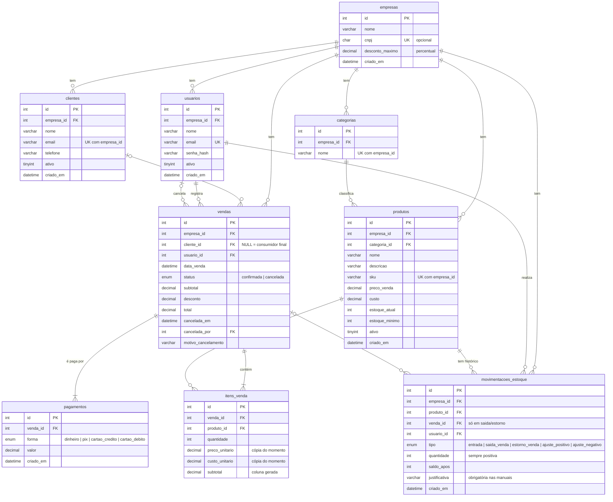

# SalesFlow — DER e modelagem do banco

Este documento acompanha o `schema.sql`. O diagrama abaixo usa **Mermaid**, que o GitHub renderiza automaticamente. Se você preferir o DER no **brModelo** (como nas aulas), as tabelas, colunas e cardinalidades da seção 2 trazem tudo o que precisa para redesenhar.

## 1. Diagrama

## 2. Relacionamentos (cardinalidades)

| Relacionamento | Cardinalidade | Como é implementado |
|---|---|---|
| empresa → usuários | 1 : N | `usuarios.empresa_id` (obrigatório) |
| empresa → categorias / produtos / clientes / vendas | 1 : N | `empresa_id` em cada tabela |
| categoria → produtos | 1 : N | `produtos.categoria_id` (obrigatório) |
| cliente → vendas | 1 : N, **opcional** | `vendas.cliente_id` aceita `NULL` (consumidor final) |
| usuário → vendas (quem registrou) | 1 : N | `vendas.usuario_id` (obrigatório) |
| usuário → vendas (quem cancelou) | 1 : N, opcional | `vendas.cancelada_por`, só preenchido se cancelada |
| venda → itens | 1 : N (mínimo 1) | `itens_venda.venda_id`; o "mínimo 1" é regra do back-end |
| produto → itens | 1 : N | `itens_venda.produto_id` |
| venda → pagamentos | 1 : N | `pagamentos.venda_id`; no V1 o sistema grava 1 por venda |
| produto → movimentações | 1 : N | `movimentacoes_estoque.produto_id` |
| venda → movimentações | 1 : N, opcional | `movimentacoes_estoque.venda_id`, só em saída/estorno |

**Venda ↔ produto é N : N.** Uma venda tem vários produtos e um produto aparece em várias vendas. A tabela `itens_venda` resolve isso e ainda guarda dados próprios da relação (quantidade, preço e custo do momento).

## 3. Decisões de modelagem (e o porquê)

1. **Isolamento entre empresas no próprio banco.** As chaves estrangeiras são *compostas*: por exemplo, `vendas (cliente_id, empresa_id)` aponta para `clientes (id, empresa_id)`. Assim o MySQL recusa uma venda da empresa 2 com cliente da empresa 1, mesmo que o código tenha um bug. (Testado: erros 1452 nos testes 2, 3 e 4.) O isolamento nas consultas continua sendo feito pelo `WHERE empresa_id = ?`; o banco é a segunda barreira.
2. **`itens_venda` guarda `preco_unitario` e `custo_unitario`.** São cópias do produto no momento da venda. Mudar o preço do produto depois não altera vendas antigas, e o lucro bruto usa o custo da época.
3. **Desconto no nível da venda.** `subtotal`, `desconto` e `total` ficam em `vendas`, e um `CHECK` garante `total = subtotal - desconto`. O limite (percentual) vem de `empresas.desconto_maximo` e é verificado pelo back-end, porque um `CHECK` não consegue consultar outra tabela.
4. **Nada é apagado.** Não há `ON DELETE CASCADE`. Tentar apagar uma venda com itens ou um produto já vendido dá erro de chave estrangeira. Produtos e clientes são *inativados* (`ativo = 0`). Venda cancelada continua na tabela com `status = 'cancelada'`.
5. **Estoque em dois lugares, de propósito.** `produtos.estoque_atual` é o saldo rápido (usado para travar e conferir na venda). `movimentacoes_estoque` é o livro-razão: cada linha traz a quantidade, o tipo e o `saldo_apos`. As duas sempre mudam na mesma transação, e as consultas C1 e C2 do `consultas.sql` conferem se batem.
6. **Quantidade sempre positiva nas movimentações.** O sentido (entra ou sai) vem do `tipo`. Isso evita a ambiguidade de "quantidade negativa de uma saída".
7. **Pagamentos em tabela própria.** Já preparada para dividir o pagamento no futuro. No V1 há uma linha por venda, com `valor = total`.
8. **Dinheiro em `DECIMAL(10,2)`.** Nunca `FLOAT`: ele não representa 0,10 exatamente e acumula erros de centavos.
9. **Datas em UTC.** Fortaleza não tem horário de verão (fixo UTC−3), então converter é simples e seguro. As consultas filtram a coluna pura (usa o índice) e só convertem na hora de agrupar por dia/mês.
10. **`ENUM` para status, forma de pagamento e tipo de movimentação.** Conjuntos pequenos e fixos. Se algum dia precisarem ser editáveis pelo usuário, viram tabelas.
11. **Collation `utf8mb4_0900_ai_ci`.** Buscas ignoram maiúsculas e acentos ("agua" encontra "Água"), e o `UNIQUE` do e-mail também (testado: `MARINA@...` conflita com `marina@...`).
12. **Índices pensados para o dashboard.** `vendas (empresa_id, status, data_venda)` atende ao filtro de todas as consultas de indicador; `movimentacoes_estoque (produto_id, criado_em)` atende ao histórico do produto.

## 4. O que o banco garante × o que fica para o back-end

| Garantido pelo MySQL | Fica para o back-end (etapas seguintes) |
|---|---|
| Estoque nunca negativo (`CHECK`) | Conferir estoque *antes* e devolver mensagem amigável |
| `total = subtotal - desconto` | Calcular os valores; nunca confiar nos valores vindos do navegador |
| Item com quantidade > 0, preço e custo ≥ 0 | Venda com ao menos 1 item |
| Cancelamento coerente (data, usuário e motivo juntos) | Impedir cancelar duas vezes (travar a linha e conferir o status) |
| Movimentação manual com justificativa; de venda com `venda_id` | Gravar saída/estorno e atualizar o saldo na mesma transação |
| Nada cruza dados entre empresas (FKs compostas) | Filtrar por `empresa_id` da sessão em toda consulta |
| SKU único por empresa, e-mail único | Desconto ≤ `desconto_maximo` da empresa |
| Histórico não pode ser apagado (FKs sem cascade) | Soma dos pagamentos = total da venda |
| | Duas vendas simultâneas do mesmo produto (`SELECT ... FOR UPDATE`) |
